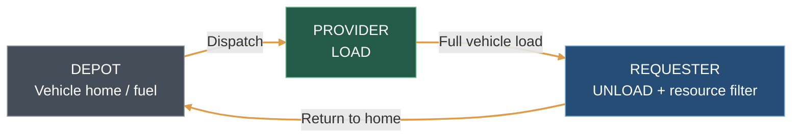
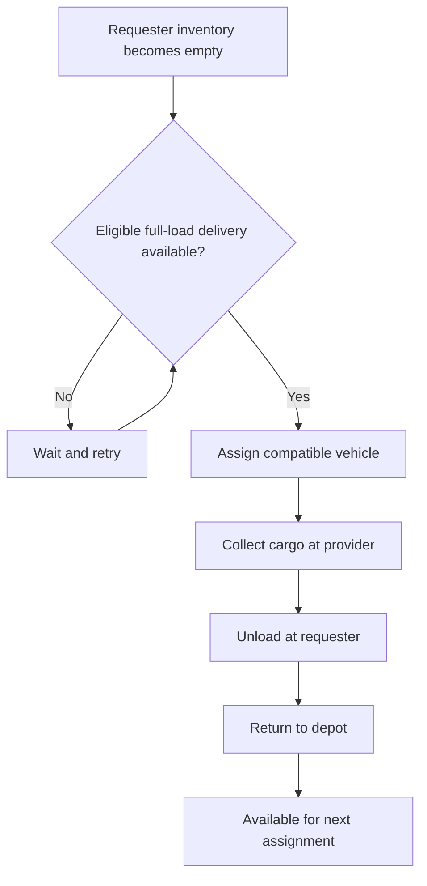
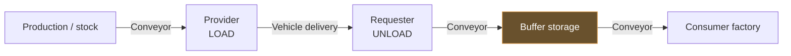

# FicsIt\* Logistics Network (FILN)

**Build a logistics network, not a collection of fixed truck routes.**

`0.01b · Early Beta` • `0.0.1-beta.1` • `Native C++ / SML 3.12.1`

[Quick start](#quick-start) · [How dispatch works](#how-dispatch-works) · [Logistics Organizer](#5-monitor-your-network) · [Troubleshooting](#troubleshooting) · [Development](#development) · [Report a bug](https://github.com/ninber/FicsItLogisticsNetwork/issues)

> **Early experimental beta.** Test on a new world or a disposable copy of a save. Back up your saves before installing FILN. Multiplayer, fluid transport, existing-save migration and safe removal are not fully validated. The instructions describe the intended player workflow; see the acceptance report for outstanding tests.

## Core concept

FILN is an experimental logistics automation mod designed to turn independent truck routes into a coordinated industrial transportation network. Instead of assigning a permanent delivery route to each vehicle, define where resources are available and where they are needed. FILN is designed to assign deliveries dynamically from a fleet of depot-based vehicles.



### Features under development

| Fleet automation | Resource logistics | Monitoring |
| --- | --- | --- |
| Automatic vehicle dispatch | Resource-specific stations | In-game Logistics Organizer |
| Dedicated home depots | Dynamic provider/requester selection | Cargo and destination information |
| Automatic refueling | Full-load delivery policy | Supply and demand |
| Cargo-aware scheduling | Solid transport; experimental fluids | Optional local web dashboard |

FILN is a native SML mod. No Lua dispatcher, UE4SS or Smarter Truck Stations dependency is required for its native runtime.

## Quick start

Install FILN through [Satisfactory Mod Manager / SMR](https://ficsit.app/) when the beta package is approved and available. The beta targets SML **3.12.1** and game build **CL 520140**; check compatibility before installing. A GitHub source archive is not an installable mod.

Start small: one depot, one provider, one requester, one vehicle and a single solid resource. Connect the stations with accessible roads and supply power to all stations.

### 1. Build a Depot

| Building | Mode | Connections | Cargo |
| --- | --- | --- | --- |
| **FILN Depot** | LOAD | Power + vehicle fuel input | Empty; no cargo connections |

- Build a **FILN Depot** from the build menu.
- Connect it to power and supply vehicle fuel through the fuel input.
- Keep its main cargo inventory empty and leave its cargo connections unused.
- Keep the station in **LOAD** mode.

Each depot serves as a home and refueling station for one vehicle. Build additional depots as your fleet grows.

### 2. Build a Provider

| Building | Mode | Connections | Cargo |
| --- | --- | --- | --- |
| **Truck Station** | LOAD | Power + cargo input | Available supply of one resource |

- Build an ordinary Truck Station near a production facility or storage.
- Set it to **LOAD** mode.
- Connect production or storage to its cargo inputs.
- Keep one type of resource in its cargo inventory, with sufficient stock for a vehicle load.

FILN discovers available resources at eligible provider stations automatically. No manual resource registration is required. Depots are not providers.

### 3. Build a Requester

| Building | Mode | Connections | Cargo |
| --- | --- | --- | --- |
| **FILN Logistics Station** | UNLOAD | Power + cargo output | One explicitly selected resource |

- Build a **FILN Logistics Station** at the destination.
- Set it to **UNLOAD** mode.
- Open the **FILTERS** tab and select the resource you want delivered.
- Connect the station's cargo outputs to your production facility or storage.

Each requester requests one specific resource. Build additional requester stations for different resources. An unconfigured station does not request deliveries.

> **Tip:** Configure an empty, undocked station. Wait for the selector to confirm the resource. A rejected selection is not an active request.

### 4. Assign a vehicle

- Build a compatible vehicle and supply it with fuel.
- Assign a route that includes a FILN Depot using the normal vehicle controls.
- Enable autopilot.

FILN is designed to enroll the vehicle automatically. You do not need to manually assign individual delivery routes between providers and requesters. Each depot should have room for its assigned vehicle. Additional depots are needed as the fleet grows.

### 5. Monitor your network

Open the built-in **FILN Logistics Organizer** during normal gameplay:

<kbd>Ctrl</kbd> + <kbd>Shift</kbd> + <kbd>L</kbd>

| Tab | Information |
| --- | --- |
| Vehicles | Current assignments, cargo, destinations and vehicle status |
| Stations | Resource supply and demand |
| Diagnostics | Station and dispatcher diagnostics |

Press <kbd>Esc</kbd> or CLOSE to dismiss the Organizer. No additional software is required for this in-game interface.

The optional browser-based dashboard requires a separate local companion process; it is not needed for normal gameplay or logistics automation. See the [Organizer documentation](workspace/mods/FicsItLogisticsNetwork/docs/ORGANIZER.md) and [native dashboard notes](workspace/specs/014-native-completion/native-dashboard.md). The keyboard binding and cooked UI still require documented runtime acceptance; remote multiplayer clients do not yet receive the Organizer snapshot.

## How dispatch works

FILN is designed to deliver full vehicle loads rather than small individual shipments. A requester generates delivery demand when its inventory becomes empty. The dispatcher considers compatible vehicles, supply, cargo, station capacity and reachable routes before assigning a delivery.



This is the normal delivery cycle, not a guarantee that every attempted delivery succeeds. Recovery, retained cargo, fuel and road eligibility can affect actual vehicle behavior.

### Keep your factory supplied

**Buffer storage is recommended.** Because a new request is generated when the requester station becomes empty, feed production from a buffer rather than directly relying on the station's inventory during transport.



For example, connect an iron plate provider to a requester configured for iron plates, then connect that requester's output to a storage container feeding the factory. The buffer can supply production while the next truck is on its way. Size buffers for actual consumption and delivery intervals.

### Fluid logistics

For fluid transportation, use **FILN Fluid Depot**, compatible fluid provider stations and **FILN Fluid Logistics Station** as your requester, together with compatible vehicles.

Solid and fluid logistics follow the same operating principles. Fluid transportation is currently being tested and should be considered experimental. Do not mix incompatible cargo media.

## Troubleshooting

| Symptom | Check first |
| --- | --- |
| Vehicle remains at the depot | Autopilot enabled, sufficient fuel, reachable roads, available compatible depot and eligible delivery |
| Requester does not get a delivery | UNLOAD mode, power, confirmed resource filter, empty cargo inventory and matching supply |
| Provider is not selected | LOAD mode, power, single matching resource, enough stock and compatible transport |
| Depot is not accepted | Dedicated FILN depot, LOAD mode, power, empty cargo inventory and fuel-only connections |
| Organizer does not open | Normal gameplay, no other interaction menu open, check key binding; see [Organizer notes](workspace/mods/FicsItLogisticsNetwork/docs/ORGANIZER.md) |
| Browser dashboard is unavailable | Separate local companion is not running; this is independent of the in-game Organizer |

If the issue persists, report it rather than repeatedly changing routes or removing FILN from an important save.

## Early Beta — 0.01b

This is a very early experimental release intended for community testing and feedback. Some features may be incomplete or behave unexpectedly.

- Start with a small logistics network on a disposable save.
- Do not assume automatic conversion of existing stations or truck routes.
- Do not rely on multiplayer, fluid behavior or safe removal until validated.
- Keep your original save and backups.

[Report an issue](https://github.com/ninber/FicsItLogisticsNetwork/issues) with the mod version, game build, SML version, steps to reproduce, observed behavior and relevant redacted logs. Screenshots of station settings or Organizer diagnostics are helpful.

## Development

The canonical implementation is [Spec Kit feature 014](workspace/specs/014-native-completion/spec.md). See the [consistency audit](workspace/specs/014-native-completion/consistency-audit.md), [release requirements](workspace/RELEASE.md), [beta release notes](workspace/RELEASE-0.0.1-beta.1.md), [development setup](DEVELOPMENT.md), [native build instructions](workspace/mods/FicsItLogisticsNetwork/docs/HEADLESS.md) and [acceptance matrix](workspace/specs/014-native-completion/acceptance.json).

- `workspace/mods/FicsItLogisticsNetwork`: canonical native SML C++ mod. Dispatch, home ownership/overflow, transfer receipts, station resource selection, native Organizer and dashboard telemetry are implemented in source; outstanding shipping/runtime acceptance remains required.
- `workspace/experiments/FILNLua`: separate historical UE4SS/KDataForge experiment and behavior reference, not native runtime. Its dashboard frontend is reused by the native read-only service. Do not install the Lua dispatcher alongside native tests.

### Host checks

```bash
bash scripts/test-filn.sh
python3 -m unittest discover -s scripts/tests
python3 scripts/check-release-compliance.py
python3 scripts/report-native-acceptance.py
```

The acceptance report must fail while requirements remain unresolved. Host tests and a successful package build do not prove runtime compatibility. Historical Lua tests: `bash scripts/test-filn-lua.sh`.

Game saves, runtime state, logs, local credentials, downloaded toolchains, upstream StarterProject and generated archives are excluded. Historical evidence may refer to local-only files. Never interrupt the running game, automate its UI, or migrate the original City save.

## Transparency and attribution

**AI usage:** Extensive AI-assisted programming (vibe coding) with ChatGPT and OpenAI Codex, including architecture, code, debugging, tests, documentation and release descriptions. No generative AI-created game art or audio assets are shipped; no runtime AI. The diagrams above are documentation flowcharts.

**Network activity:** Optional read-only dashboard on localhost (`127.0.0.1:8765`). Game telemetry and generated item icon cache remain local. No intended external icon requests, analytics, advertising, tracking or telemetry uploads.

No new general-purpose license is granted for FILN-owned code in this revision; earlier grants and third-party rights remain unaffected. Game/engine content retains upstream ownership. Dashboard icons are generated locally from the installed game, not distributed. Smarter Truck Stations is a technical reference only; no redistribution license was identified. See [publication compliance](workspace/PUBLICATION.md).

---

*\* Unofficial pioneer\*\* modification. Corporate approval pending for &lt;&lt;ERROR&gt;&gt; days.*

*\*\* Unofficial community of engineers.*

Not affiliated with or endorsed by Coffee Stain Studios.
