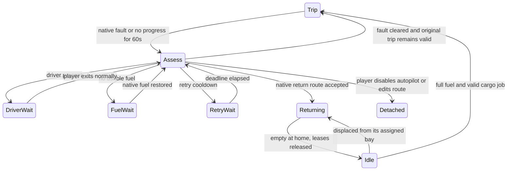

# Recovery and request diagnostics

Recovery jobs remain in the bounded observer queue. They are never removed merely because an error occurred.
Every native fault is logged with vehicle identity, home, state, substate, retry count, native error name/code,
current target, fuel, observed cargo and position. Transition records and 30-second heartbeats use `DEPOT_FSM`.
`RECOVERY_RETRY_FAILED` retains the actual failed API/reachability check and retries with 5–60 second backoff.

The return route uses a real home destination plus a distinct reachable rest-stop anchor to satisfy native
multi-station autopilot. Empty trucks return home; trucks with a known delivery item retain the original
requester before returning. No teleport, possession changes, synthetic fuel or cargo mutation occurs.
An off-road truck still needs physical road placement, and an unfueled stranded truck still needs real fuel.
Those constraints produce explicit retry/wait diagnostics instead of an unobserved permanent lock.

Partial positive pickup is logged as `DEPOT_PARTIAL_DELIVERY`; verified complete unloading and return can
complete normally using the actual quantity. New jobs still require a full truckload at selection.
A native full truck fuel slot (100 coal) is required before starting cargo dispatch.

`recover_vehicle Vn` is explicit enrollment for a repaired, empty, home-only-route truck. It may enable
its autopilot only because this command expressly opts that truck in. Normal recovery never reverses
a player's autopilot-off action. The game must not have an active driver during explicit enrollment.

Journal reload now hands owned in-flight routes to recovery with actual cargo reconciled against the
requester's explicit filter. It does not assert that an interrupted delivery completed.

Press **Ctrl+Shift+J** for a request summary in native game chat; open chat with **T** to reread it.
FILN does not bind F keys. The summary posts groups of four entries to chat and logs all entries as `REQUEST`;
it uses the last completed scheduler stock scan and identifies stock versus vehicle truckload, supplier,
and waiting reason. It is a summary rather than a route feasibility audit of every possible provider.
`filn_lua.requests` is also registered in the Unreal console; terminal helper command is `requests`.
